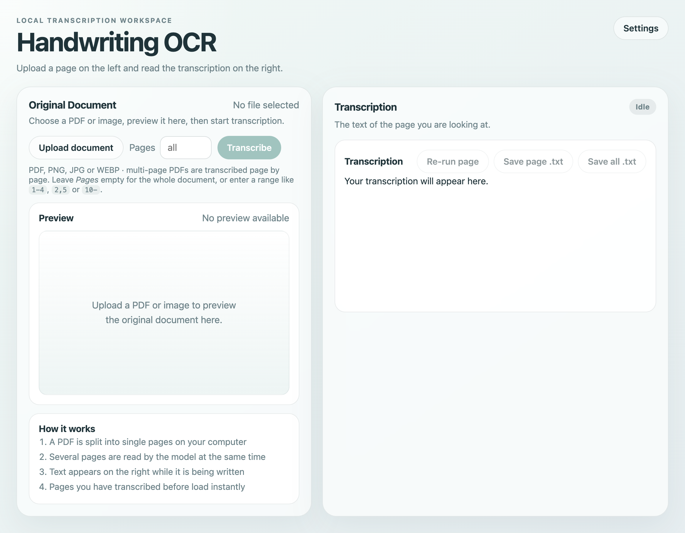

# Handwriting OCR

Turn scans of old handwriting into text you can read, search and copy.

The app is made for old German handwriting such as Kurrent and Sütterlin: letters, diaries, church records. It also works for other handwriting.



## How it works

1. You open a scan (a PDF or a photo).
2. The app sends each page to an AI model that can read handwriting.
3. The text appears next to your scan, page by page.

The AI models run on the internet, through a service called [OpenRouter](https://openrouter.ai/). You need an OpenRouter account with a little credit on it. Reading a page costs roughly one cent or less with the default model.

## Step 1: Install the app

Download the installer from the [Releases page](https://github.com/okreitz/handwriting-ocr/releases/latest).

**Windows**

1. Download the file ending in `.exe` and double-click it.
2. Windows shows a blue box saying "Windows protected your PC". Click **More info**, then **Run anyway**. This appears because the app is new and not registered with Microsoft.
3. The app installs itself and opens. You will find a shortcut on your desktop.

**Mac**

1. Download the file ending in `.dmg`. Choose `arm64` for newer Macs (M1 and later) or `x64` for older Intel Macs.
2. Open the file and drag the app into your Applications folder.
3. The first time you open it, your Mac blocks it. Open **System Settings → Privacy & Security**, scroll down, and click **Open Anyway**.

## Step 2: Add your OpenRouter key

A key is like a password that lets the app use your OpenRouter account.

1. Create an account at [openrouter.ai](https://openrouter.ai/) and add some credit (5 dollars lasts for hundreds of pages).
2. Go to [openrouter.ai/keys](https://openrouter.ai/keys) and create a key. Copy it.
3. In the app, the Settings window opens on first start. Paste the key into **API key**.
4. Click **Load models**, then **Save settings**.

You only do this once.

## Step 3: Transcribe a document

1. Click **Upload document** and pick a PDF or an image (JPG, PNG or WEBP).
2. Click **Transcribe**.
3. Read the text on the right. Use the page selector to move between pages. The scan on the left follows along.
4. Click **Save all .txt** to save the whole text, or **Save page .txt** for one page.

Tips:

- **Long PDF?** Type the pages you want into the **Pages** box before you start: `1-4` for pages 1 to 4, `2,5` for pages 2 and 5, `10-` for page 10 to the end.
- **Changed your mind?** Click **Stop**. Pages that are already done stay.
- **Square brackets** mean the model was not sure: `[Friedrich]` is a guess, `[illegible]` means it could not read the word.
- **Not happy with a page?** Click **Re-run page** to have it read again.
- **Opening the same scan again is free.** The app remembers pages it has already read.
- **A page failed?** The others still finish. The failed page is marked, with the reason shown above the text.

## Choosing a model

In **Settings → Reading model** there are three buttons:

| Button | Good for |
| --- | --- |
| **Fast** | The default. Quick, cheap and accurate. |
| **Best quality** | Difficult handwriting. Costs a few cents per page. |
| **Budget** | Large amounts of easy pages. |

Handwriting varies a lot. Before a big job, try two or three pages with each button and keep the one that reads yours best.

**Correction pass** (off by default) lets a second model tidy up the text afterwards. It makes every page take longer and cost more, and usually is not needed.

## Your privacy

- The app runs on your own computer.
- Only the pages you transcribe are sent out, to OpenRouter and the AI model you chose.
- Your key is stored on your computer, in encrypted form.

## Problems?

| What you see | What to do |
| --- | --- |
| "OpenRouter API key is missing" | Open **Settings** and paste your key (Step 2). |
| A page fails with a rate limit message | Wait a minute and click **Re-run page**. If it keeps happening, open **Settings → Advanced** and lower "Pages read at the same time". |
| "This image format cannot be read here" | Save the scan as JPG, PNG or PDF and try again. |
| "This PDF is password-protected" | Save a copy without a password first. |
| The text stops in the middle of a page | The model ran out of room. Click **Re-run page**, or try the **Best quality** model. |

---

## For developers

Requires Node.js 20 or newer.

```bash
npm install
```

Run in the browser:

```bash
npm start
```

Run as a desktop app:

```bash
npm run desktop
```

Run the tests:

```bash
npm test
```

**Where things are**

| Path | Role |
| --- | --- |
| `server/index.js` | Local web server: pages, settings, model list, `/api/transcribe` |
| `server/transcription-service.js` | Reads pages in parallel, caches results, optional correction |
| `server/openrouter.js` | Talks to OpenRouter: streaming, retries, timeouts |
| `server/pdf-pages.js` | Page ranges and PDF splitting |
| `server/settings-store.js` | Default settings, settings file, key handling |
| `public/` | The user interface (plain HTML, CSS and JavaScript, no build step) |
| `desktop/main.js` | Electron window around the local server |

Settings and the page cache live in `%APPDATA%\handwriting-ocr\data` on Windows, `~/Library/Application Support/handwriting-ocr/data` on macOS, and `data/` in the project folder when run from source.

**Making a release**

Push a version tag. GitHub then builds the Windows and Mac installers and attaches them to a draft release for you to review and publish.

```bash
git tag v0.2.0
```

```bash
git push origin v0.2.0
```

To build on your own machine instead (files land in `dist/`):

```bash
npm run dist -- --win
```

```bash
npm run dist -- --mac
```

The installers are not code-signed, which is why Windows and macOS show a warning on first start.
